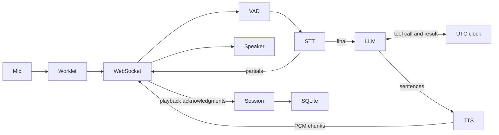

# Voice agent design

The browser requests microphone access before creating a session. The `AudioWorklet` emits 20 ms packets of signed little-endian mono PCM at 16 kHz. The server sends signed little-endian mono PCM at 24 kHz. Calls use an opaque UUID and one socket per session. Sessions are bound to a single local process.

## Transport

| Direction | Message | Fields |
| --- | --- | --- |
| HTTP | POST /sessions | Returns session_id and audio configuration |
| HTTP | GET /sessions/:id | Session, transcript, metrics and errors |
| C → S | binary | 640-byte PCM microphone frame |
| C → S | interrupt | turn_id, played_sentences |
| C → S | playback | turn_id, played_sentences |
| C → S | playback_started | turn_id |
| C → S | playback_done | turn_id |
| C → S | end_call | No additional fields |
| S → C | state | state, optional turn_id |
| S → C | transcript_partial | text |
| S → C | transcript_final | text, turn_id |
| S → C | agent_text | text, turn_id, optional sentence index |
| S → C | agent_audio | JSON metadata immediately followed by one binary chunk |
| S → C | sentence_end | turn_id, sentence index |
| S → C | reply_end | turn_id |
| S → C | error | code, message |
| S → C | call_ended | reason |

Outbound text and audio are tagged by turn. The browser immediately discards queued audio on interruption. Completed sentences are acknowledged after playback and form the agent history. Interrupting mid-sentence records only the previously completed sentences, so upcoming text is never treated as spoken.

## Runtime interfaces

- STT opens a stream with a partial callback and abort signal. The stream supports write and finish.
- LLM streams text with an abort signal and uses an injected clock tool executor.
- TTS streams raw PCM for a sentence with an abort signal.
- VAD uses sustained RMS above a configurable noise floor, minimum voiced duration, and trailing silence. Server audio activity can interrupt thinking; the browser also checks microphone energy during playback for lower stop latency.
- The session tracks VAD end, STT final, LLM first text, TTS first audio, and browser playback start. SQLite saves session snapshots after meaningful events and at teardown. Timeout termination attempts a short spoken goodbye and waits for its playback.

