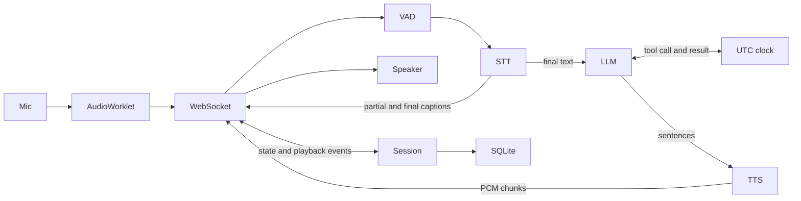

# Voice Agent MVP

A local browser voice call with live captions, interruption, conversation history and a UTC clock tool. The server persists transcripts, tool results, errors and timing in SQLite.

## Run locally

Use Node.js 24 or newer and a browser with AudioWorklet support. From this directory, run:

```sh
npm ci
npm start
```

Open [the local app](http://localhost:3000), click **Start Call**, and allow microphone access. Localhost supports microphone access. Serving the browser over a non-localhost address requires HTTPS. The server binds to loopback by default. The MVP has no authentication, so keep it on a trusted machine.

### Scripted mode

The default mode uses local audio fixtures and scripted recognition. Speak for a moment and pause between turns. The recognized text follows this scenario in order.

1. My name is Maya.
2. I am planning a weekend in Kyoto.
3. I like quiet gardens.
4. Which city am I visiting?
5. What time is it?
6. What is my name?

For barge-in, start turn 4 during the reply to turn 3. The interruption stops the audio, and the next reply uses the earlier destination. The clock tool reads current UTC time. Scripted mode shows its dynamic result in the transcript while playing a fixed acknowledgement.

### Live mode

Copy `.env.example` to `.env`, set `VOICE_MODE=live`, and set `DEEPGRAM_API_KEY` and `OPENAI_API_KEY` locally. Restart the server and talk naturally. Keep credentials in the server environment. Live mode sends microphone audio to Deepgram and sends transcripts and reply text to OpenAI.

| Environment variable | Default | Description |
| --- | --- | --- |
| `VOICE_MODE` | `mock` | `mock` or `live` |
| `HOST`, `PORT` | `127.0.0.1`, `3000` | HTTP and WebSocket listener |
| `SESSION_DB` | `data/sessions.sqlite` | SQLite database path |
| `DEEPGRAM_API_KEY`, `OPENAI_API_KEY` | Empty | Server-side live credentials |
| `STT_MODEL`, `LLM_MODEL` | `nova-3`, `gpt-4o-mini` | Recognition and response models |
| `TTS_MODEL`, `TTS_VOICE` | `gpt-4o-mini-tts`, `alloy` | Speech model and voice |
| `SYSTEM_PROMPT`, `PROMPT_VERSION` | Built in, `1` | Prompt and saved version |
| `VAD_THRESHOLD`, `VAD_SILENCE_MS` | `0.018`, `600` | PCM RMS floor and end-of-speech pause |
| `IDLE_MS`, `MAX_CALL_MS` | `120000`, `900000` | Silence and maximum call duration |
| `PROVIDER_TIMEOUT_MS`, `PLAYBACK_TIMEOUT_MS` | `12000`, `45000` | Stage and playback limits |

## Architecture



- `server.js` serves the UI, HTTP session endpoints, the WebSocket and SQLite storage.
- `session.js` owns VAD, state transitions, tool execution, provider cancellation, playback acknowledgments and metrics.
- `providers.js` implements the streaming adapters. To change a provider, implement the corresponding interface and register it in the provider factory or inject it into `createApp`. The session consumes the same interface.
- `web/` captures 16 kHz PCM and plays 24 kHz PCM using Web Audio. The interruption path stops queued audio in the browser and aborts the server-side turn.
- [Design and event schema](DESIGN.md) describes the transport and provider interfaces. The **View session data** link opens `GET /sessions/:id`.

Provider references are available in the [Deepgram streaming STT reference](https://developers.deepgram.com/reference/speech-to-text/listen-streaming), [OpenAI chat completion reference](https://platform.openai.com/docs/api-reference/chat/create), and [OpenAI text-to-speech guide](https://developers.openai.com/api/docs/guides/text-to-speech).

## Verify

```sh
npm test
npm run benchmark -- latency-report
```

The integration suite uses a local HTTP listener and recorded speech. Tests cover state transitions, the OpenAI streaming adapter with mocked transport, multi-turn context, persistent timing, tool calls, interruption, provider failures, disconnect and timeout goodbyes. The latency command replays 20 turns at real-time audio cadence and writes Markdown and raw JSON to the supplied filename stem.

[Included latency report](latency-report.md) and [raw samples](latency-report.json) are from the credential-free scripted run. Rerun the benchmark with live credentials to evaluate the 1.5 s target. The benchmark measures first server audio. Browser sessions also log first scheduled playback, including the client acknowledgment round trip.

### Known limits

- The RMS VAD filters quiet input and short bursts. Sustained loud background noise can trigger it. Headphones help when using the microphone near a speaker.
- Interruption history retains sentences with completed playback acknowledgments. It excludes the unfinished sentence, even if a fragment was audible.
- Live provider behavior and latency require verification against actual credentials and network conditions.

